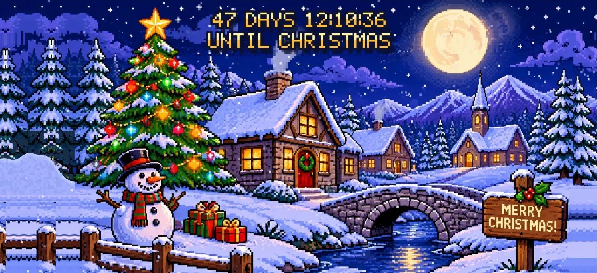
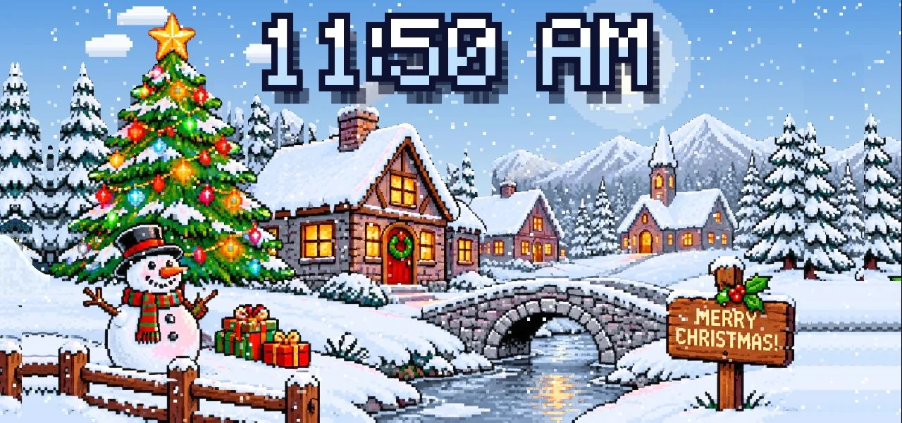
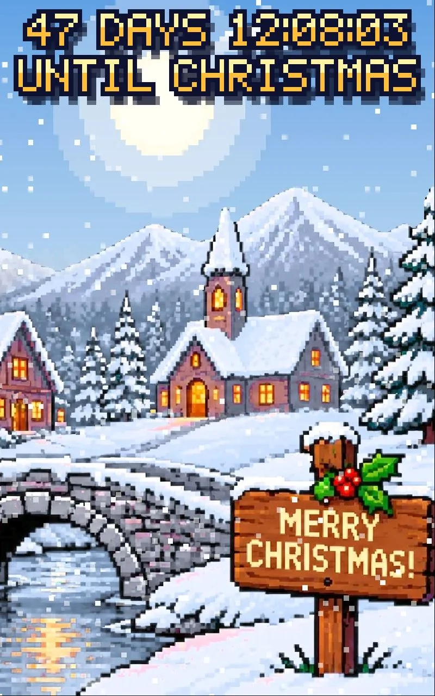

# Christmas Village

A [Kiosk Satellite](https://kiosksatellite.com) screensaver: an animated pixel art Christmas village that follows the time of day. By day the sun shines on the snow and clouds drift past. Towards sunset the sky turns orange and pink, and at night the moon comes up, the stars twinkle and Santa's sleigh flies across the sky. All day long the snow falls, the tree lights twinkle, the chimneys smoke and the river shimmers.







## Installation

### Manual

1. Open **Settings > Plugin Manager** in Kiosk Satellite and turn on **Enable Plugins**.
2. Choose **Add plugin**, paste `https://github.com/MozKaboom/Christmas-countdown-pixel-art-screensaver` and choose **Preview**.
3. Review the plugin and choose **Trust and install**.

## Use it

1. Enable **Christmas Village** from its entry row in Plugin Manager.
2. Open **Screensaver > Screensaver mode** and pick **Christmas Village (Christmas Village)**. You can also pick it in a screensaver schedule entry.
3. Start the screensaver from the kiosk menu, or wait for the idle timeout.

The village fills the screen's height with no borders, in landscape and portrait. The picture is much wider than the screen, with pine woods and snowy fields either side of the village, so it scrolls slowly from side to side to show it all.

## Settings

| Setting | What it does |
| --- | --- |
| Time of day | **Follow the clock** uses the kiosk's own time. **Always day** and **Always night** hold one look. **A day every 3 minutes** runs through a whole day, sunrise to night, to show it all off. |
| Sunrise | When it gets light. The sky starts to brighten about 50 minutes before. Default 08:00. |
| Sunset | When it gets dark. The sunset glow starts about 50 minutes before. Default 16:00. |
| Snow | None, Light, Steady or Blizzard. A blizzard is thick, fast and blows sideways. |
| Santa flies past | How often Santa's sleigh crosses the sky at night: never, or every 1, 2, 5, 10 or 30 minutes. He also flies past soon after the screensaver starts. Default every 2 minutes. |
| Clock | Off, 24 hour or 12 hour. Shows the time at the top of the screen in pixel lettering, like a 16-bit game. |
| Countdown to Christmas | Shows the days, hours, minutes and seconds until Christmas Day under it. On Christmas Day it says Merry Christmas! |
| Show diagnostics | Shows the screen size, frame rate, whether the pictures loaded and any errors in the corner, for tracking down a problem. |

## Data and privacy

Christmas Village makes no network requests and stores nothing. Everything it shows is inside the plugin.

## How it works

The screensaver is a web page in the plugin's `assets/village` folder, which Kiosk Satellite shows as a packaged screensaver. It draws the village by night and by day and blends between them as the clock moves through dawn and dusk. The snow, lights, stars, smoke, river and clouds are drawn on a layer of pixels the same size as the art's own, so they look part of the picture.

To try the page on a computer, serve `assets/village` with any web server and open `index.html`. Add `?t=17:00` to see a set time of day, or `?demo` to run through a whole day in three minutes.

## Credits

- The village artwork is by MozKaboom.

## Build

Install Python 3, JDK 17 or newer and an Android SDK with a platform and build-tools. Set `ANDROID_HOME` and `JAVA_HOME` as needed.

```sh
python3 tools/test.py
python3 tools/build.py
```

The build creates `dist/christmas-village-screensaver-<version>.zip`. To try it, open **Plugin Manager > Developer Tools > Install from ZIP** in Kiosk Satellite.

Releases are built by the GitHub Actions workflow in `.github/workflows/build.yml` when a release is published.

## License

[Apache-2.0](LICENSE) for the code. The SDK interfaces in `sdk/` and the build tools in `tools/` come from the [Kiosk Satellite plugin template](https://github.com/jxlarrea/kiosk-satellite-plugins) under the same license.
